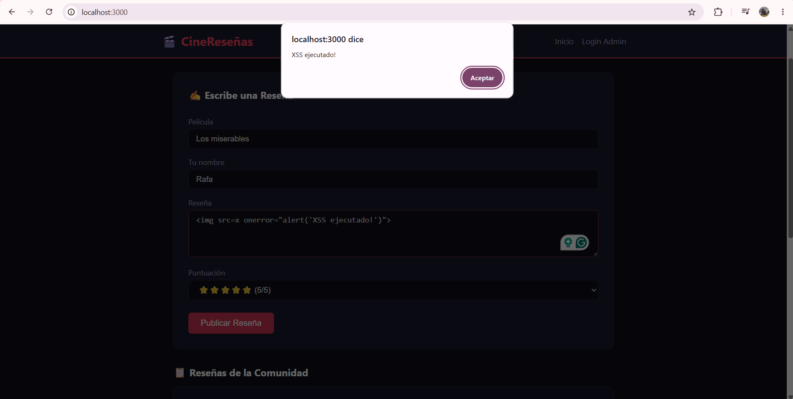

# CineReseñas — Informe de Seguridad

> **Propósito:** Documento pedagógico para proyecto final de Optativa.
> **Entorno de pruebas:** Local — `http://localhost:3000`

---

## Índice

- [4.1 Descripción del sistema](#41-descripción-del-sistema)
- [4.2 Identificación y caracterización](#42-identificación-y-caracterización)
  - [Vulnerabilidad #1 — XSS (Cross-Site Scripting)](#vulnerabilidad-1--xss-cross-site-scripting)
  - [Vulnerabilidad #2 — Credenciales Hardcodeadas y Bypass de Autenticación](#vulnerabilidad-2--credenciales-hardcodeadas-y-bypass-de-autenticación)

---

## 4.1 Descripción del sistema

### Propósito de la aplicación

CineReseñas es una aplicación web que permite a cualquier visitante publicar reseñas de películas y a un administrador gestionar (eliminar) el contenido publicado. El propósito en este contexto es servir como entorno pedagógico controlado para identificar, explotar y corregir vulnerabilidades de seguridad web comunes.

### Usuarios y funciones principales

| Rol | Funciones |
|---|---|
| **Usuario anónimo** | Ver reseñas publicadas, publicar una nueva reseña (película, autor, texto, puntuación) |
| **Administrador** | Iniciar sesión con credenciales, acceder al panel de administración, eliminar reseñas |

### Tecnologías utilizadas

| Capa | Tecnología |
|---|---|
| Runtime del servidor | Node.js v24 |
| Framework backend | Express 5.3.0 |
| Frontend | HTML5, CSS3, JavaScript (vanilla, sin frameworks) |
| Persistencia | Arreglo en memoria (no hay base de datos) |
| Gestión de dependencias | npm 11.13.0 |

La única dependencia de producción declarada en `package.json` es `express`. No se utiliza ninguna librería de sanitización, autenticación ni manejo de sesiones.

### Componentes principales

```
optativa-final/
├── server.js              ← Servidor HTTP, rutas de la API REST, lógica de negocio
├── package.json           ← Configuración del proyecto y dependencias
└── public/                ← Archivos estáticos servidos al navegador
    ├── index.html         ← Página principal: listado y formulario de reseñas
    ├── login.html         ← Formulario de autenticación del administrador
    ├── admin.html         ← Panel de administración (gestión de reseñas)
    ├── css/
    │   └── styles.css     ← Estilos globales de la aplicación
    └── js/
        ├── auth.js        ← Lógica de "sesión" en el cliente (localStorage)
        ├── main.js        ← Carga y renderizado de reseñas en la página principal
        ├── login.js       ← Manejo del formulario de login
        └── admin.js       ← Renderizado y eliminación de reseñas en el panel admin
```

**`server.js`** expone cuatro endpoints:

| Método | Ruta | Descripción |
|---|---|---|
| `GET` | `/api/reviews` | Retorna todas las reseñas en memoria |
| `POST` | `/api/reviews` | Crea una nueva reseña |
| `POST` | `/api/login` | Valida credenciales y retorna `{ success: true }` |
| `DELETE` | `/api/reviews/:id` | Elimina una reseña si el header `x-admin: true` está presente |

Los archivos de `public/` son servidos como estáticos por Express mediante `express.static`.

### Diagrama de arquitectura y flujo de datos

```
                          NAVEGADOR (Cliente)
  ┌─────────────────────────────────────────────────────────┐
  │                                                         │
  │   index.html / login.html / admin.html                  │
  │         │                                               │
  │    ┌────▼──────────────────────────────┐                │
  │    │  JavaScript (main.js / admin.js)  │                │
  │    │  - fetch('/api/reviews')          │                │
  │    │  - innerHTML ← datos de la API   │  ← XSS aquí   │
  │    └────────────────────────────────── ┘                │
  │         │                                               │
  │    ┌────▼────────────────┐                              │
  │    │     auth.js         │                              │
  │    │  localStorage       │  ← Bypass auth aquí         │
  │    │  isAdmin = 'true'   │                              │
  │    └─────────────────────┘                              │
  └──────────────┬──────────────────────────────────────────┘
                 │  HTTP (fetch / form submit)
                 ▼
          SERVIDOR (Node.js + Express — puerto 3000)
  ┌─────────────────────────────────────────────────────────┐
  │  server.js                                              │
  │                                                         │
  │  GET  /api/reviews   → retorna array reviews[]          │
  │  POST /api/reviews   → guarda sin sanitizar  ← XSS     │
  │  POST /api/login     → compara con constantes ← Auth   │
  │  DELETE /api/reviews/:id → verifica header   ← Auth    │
  │                                                         │
  │  Almacenamiento: arreglo en memoria (reviews[])         │
  └─────────────────────────────────────────────────────────┘
```

**Flujo de una reseña (camino del dato que habilita el XSS):**

```
Usuario escribe texto  →  POST /api/reviews  →  reviews[] en memoria
                                                      │
                                            GET /api/reviews
                                                      │
                                          renderReviews() en main.js
                                                      │
                                          container.innerHTML = ...
                                                      │
                                     Navegador interpreta y ejecuta HTML
```

### Alcance autorizado de las pruebas

Las pruebas de seguridad están autorizadas únicamente sobre el entorno local (`http://localhost:3000`). No existe ningún entorno de producción ni servicio externo involucrado. El alcance cubre:

- Los cuatro endpoints de la API (`/api/reviews` GET/POST, `/api/login`, `/api/reviews/:id` DELETE)
- Las páginas `index.html`, `login.html` y `admin.html`
- La manipulación del `localStorage` del navegador desde las DevTools
- El uso de la consola del navegador para enviar peticiones HTTP directas

No se requieren herramientas externas para demostrar las vulnerabilidades. Todo puede realizarse desde el navegador.

---

## 4.2 Identificación y caracterización

---

### Vulnerabilidad #1 — XSS (Cross-Site Scripting)

#### Descripción técnica

Cuando un usuario envía una reseña, el servidor almacena el texto tal como llega, sin ningún procesamiento. Cuando otro usuario (o el mismo) carga la página, el JavaScript del cliente recupera las reseñas vía `GET /api/reviews` y las inserta en el DOM usando la propiedad `innerHTML`. Esta propiedad interpreta el string como HTML, lo que significa que cualquier etiqueta o manejador de eventos incluido en el texto será parseado y ejecutado por el navegador. El resultado es que código JavaScript arbitrario introducido por un usuario se ejecuta en el contexto de la página para todos los visitantes.

#### Fragmento de código afectado

**`server.js` — almacenamiento sin sanitización:**

```javascript
// POST /api/reviews
app.post('/api/reviews', (req, res) => {
  const { movie, author, text, rating } = req.body;

  // ⚠️ Ningún campo es validado, escapado ni sanitizado antes de guardarse
  const newReview = {
    id: nextId++,
    movie,
    author,
    text,
    rating: parseInt(rating),
  };

  reviews.push(newReview);
  res.status(201).json(newReview);
});
```

**`public/js/main.js` — renderizado con `innerHTML`:**

```javascript
container.innerHTML = reviews
  .map(
    (r) => `
    <div class="review-card">
      <span class="movie-title">${r.movie}</span>
      <span class="review-meta">por ${r.author}</span>
      <p class="review-text">${r.text}</p>
      <span class="review-rating">${stars(r.rating)}</span>
    </div>
  `
  )
  .join('');
```

Lo mismo ocurre en **`public/js/admin.js`** dentro de `renderAdminReviews()`, donde los campos `r.movie`, `r.author` y `r.text` también se interpolan directamente en un template literal asignado a `innerHTML`.

**Evidencia — Estado inicial (sin payload inyectado):**


**Evidencia — Inyección del payload en el formulario:**


**Evidencia — Ejecución del XSS en el navegador:**



#### Origen de la vulnerabilidad

**Implementación.** La decisión de usar `innerHTML` en lugar de métodos seguros del DOM como `textContent` o `createElement` es un error de codificación. No es un problema de diseño de la arquitectura ni de configuración del servidor, sino de cómo se escribió la función de renderizado en el cliente.

#### Propiedad de seguridad comprometida

**Integridad** y **Confidencialidad**. La integridad se ve comprometida porque contenido no autorizado (código ejecutable) se inyecta y ejecuta en la página. La confidencialidad puede verse comprometida porque ese código ejecutado tiene acceso a todo el contexto del navegador en ese dominio: `document.cookie`, `localStorage`, el contenido visible de la página, y la capacidad de realizar peticiones HTTP en nombre del usuario.

#### Usuarios, datos y procesos afectados

- **Usuarios afectados:** todos los visitantes de `index.html` y todos los administradores que accedan a `admin.html`, ya que ambas páginas renderizan las reseñas con `innerHTML`.
- **Datos afectados:** cualquier información presente en `localStorage` (incluido el flag `isAdmin`), cualquier cookie accesible desde JavaScript, y el contenido visible de la página.
- **Procesos afectados:** el flujo de visualización de reseñas y el flujo de administración.

#### Categoría OWASP

**OWASP Top 10 Web — A03:2021: Injection**

El XSS pertenece a esta categoría porque el problema fundamental es que datos provenientes de una fuente no confiable (el input del usuario) son tratados como instrucciones ejecutables por el intérprete de destino (el motor HTML/JS del navegador), en lugar de ser tratados como datos. Esto es exactamente la definición de inyección: la frontera entre "datos" e "instrucciones" se pierde. En esta aplicación, el texto de una reseña —que debería ser un dato inerte— puede convertirse en código JavaScript que el navegador ejecuta, porque no existe ningún mecanismo que establezca esa frontera. La categoría A03 agrupa todas las formas de inyección (SQL, NoSQL, OS, XSS) bajo el mismo principio: ausencia de separación entre datos y código.

#### Principio de desarrollo seguro aplicable

**Validación y sanitización de entrada / Codificación de salida (Output Encoding).** El principio establece que todo dato proveniente de una fuente no controlada debe ser codificado de manera adecuada según el contexto en que será utilizado antes de ser insertado. Para contexto HTML, esto significa reemplazar caracteres especiales (`<`, `>`, `"`, `'`, `&`) por sus entidades HTML equivalentes, o bien usar APIs del DOM que no interpreten el contenido como markup, como `textContent`.

#### Impacto potencial

Dado que las reseñas se almacenan en memoria y se sirven a todos los visitantes, el payload se ejecutará de forma persistente para cada usuario que cargue la página hasta que el servidor sea reiniciado. Los efectos posibles incluyen:

- Robo del flag de sesión almacenado en `localStorage` (`isAdmin`), lo que permitiría a un atacante remoto obtener acceso al panel de administración.
- Redirección de usuarios a sitios externos.
- Modificación del contenido visible de la página (defacement).
- Envío de peticiones HTTP en nombre del usuario desde su propio navegador.

---

### Vulnerabilidad #2 — Credenciales Hardcodeadas y Bypass de Autenticación

#### Descripción técnica

Esta vulnerabilidad tiene dos componentes que se refuerzan mutuamente:

**Componente A — Credenciales en texto plano en el código fuente.** El usuario y la contraseña del administrador están definidos como constantes literales en `server.js`. No existe almacenamiento externo, hashing ni gestión de secretos. Cualquier persona que tenga acceso al archivo puede obtener las credenciales.

**Componente B — Control de acceso implementado en el cliente.** Tras un login exitoso, el servidor no establece ninguna sesión. Solo responde con `{ success: true }`. El cliente guarda entonces el string `'true'` en `localStorage` bajo la clave `isAdmin`. Toda la lógica de acceso al panel (`admin.html`) y toda verificación de si el usuario está autenticado se basa en leer ese valor de `localStorage`. Además, el endpoint `DELETE /api/reviews/:id` considera que una petición es "autorizada" si contiene el header HTTP `x-admin: true`, un header arbitrario que cualquier cliente puede enviar sin haber pasado por ningún proceso de autenticación.

#### Fragmento de código afectado

**`server.js` — credenciales hardcodeadas:**

```javascript
// ⚠️ Credenciales en texto plano directamente en el código fuente
const ADMIN_USER = 'admin';
const ADMIN_PASS = 'admin123';
```

**`server.js` — login que no genera sesión:**

```javascript
app.post('/api/login', (req, res) => {
  const { username, password } = req.body;

  if (username === ADMIN_USER && password === ADMIN_PASS) {
    // ⚠️ No se genera token ni cookie de sesión. El servidor no guarda estado.
    return res.json({ success: true, message: 'Login exitoso.' });
  }
  res.status(401).json({ success: false, message: 'Credenciales incorrectas.' });
});
```

**`server.js` — autorización por header sin firma:**

```javascript
app.delete('/api/reviews/:id', (req, res) => {
  // ⚠️ Cualquier cliente puede enviar este header sin autenticarse
  const isAdmin = req.headers['x-admin'] === 'true';

  if (!isAdmin) {
    return res.status(403).json({ error: 'Acceso denegado.' });
  }
  // ... elimina la reseña
});
```

**`public/js/auth.js` — verificación solo en el cliente:**

```javascript
function isLoggedIn() {
  // ⚠️ localStorage es modificable por cualquier usuario desde la consola
  return localStorage.getItem('isAdmin') === 'true';
}
```

**`public/js/admin.js` — control de acceso al panel basado en esa función:**

```javascript
document.addEventListener('DOMContentLoaded', () => {
  if (isLoggedIn()) {
    // ⚠️ Si localStorage.isAdmin === 'true', se muestra el panel completo
    adminContent.style.display = 'block';
    loadAdminReviews();
  } else {
    adminDenied.style.display = 'block';
  }
});
```

**Evidencia — Estado inicial (usuario no autenticado intenta acceder al panel):**


**Evidencia — Intento de acceso directo al panel por URL:**


**Evidencia — Bypass exitoso: panel de admin accesible sin autenticación:**


**Evidencia — Estado inicial de las reseñas antes de la eliminación no autorizada:**


**Evidencia — Eliminación de reseña sin autenticación via consola:**


**Evidencia — Resultado: reseña eliminada sin haber iniciado sesión:**


#### Origen de la vulnerabilidad

**Diseño y configuración.** La decisión de no implementar un mecanismo de sesión en el servidor es un error de diseño: se asume que el cliente es una fuente confiable para determinar su propio nivel de acceso. Las credenciales en texto plano son un error de configuración y gestión de secretos: se eligió codificar valores sensibles directamente en el código en lugar de externalizarlos.

#### Propiedad de seguridad comprometida

**Autenticación** y **Autorización**. La autenticación se ve comprometida porque el servidor no mantiene ningún estado que acredite que una sesión fue establecida legítimamente: el proceso de login no produce ningún artefacto verificable. La autorización se ve comprometida porque las decisiones de acceso a recursos protegidos (el panel de admin, la operación de eliminación) se toman en base a datos que el propio cliente puede fabricar libremente.

#### Usuarios, datos y procesos afectados

- **Usuarios afectados:** el administrador legítimo, cuyas credenciales están expuestas en el código fuente.
- **Datos afectados:** todas las reseñas almacenadas en memoria, que pueden ser eliminadas por cualquier persona sin autenticarse.
- **Procesos afectados:** el flujo de autenticación, el acceso al panel de administración y la operación de eliminación de reseñas.

#### Categoría OWASP

**OWASP Top 10 Web — A07:2021: Identification and Authentication Failures**

Esta categoría abarca los fallos en los mecanismos que permiten a un sistema confirmar que un usuario es quien dice ser y que su acceso ha sido legítimamente establecido. La vulnerabilidad de esta aplicación encaja en ella por dos razones concretas. Primero, las credenciales hardcodeadas en el código fuente implican que el secreto que debería ser conocido solo por el administrador es en realidad accesible para cualquiera que pueda leer el archivo `server.js`, lo que invalida el factor de autenticación. Segundo, la ausencia de sesión en el servidor significa que el sistema no puede distinguir entre una petición proveniente de alguien que se autenticó y una petición de cualquier cliente que simplemente establezca `localStorage.isAdmin = 'true'` o incluya el header `x-admin: true`. La autenticación no produce ningún artefacto que el servidor pueda verificar, lo que hace que el proceso de identificación sea efectivamente nulo desde la perspectiva del servidor.

#### Principio de desarrollo seguro aplicable

**Nunca almacenar secretos en el código fuente (Secrets Management) y verificar la autenticación en el servidor (Server-Side Enforcement).** El primer principio establece que las credenciales, claves y tokens deben externalizarse a mecanismos de gestión de secretos (variables de entorno, vaults) y nunca embeberse en el código versionado. El segundo establece que las decisiones de control de acceso deben tomarse exclusivamente en el servidor, nunca en el cliente, porque el cliente es un entorno que el usuario puede manipular libremente.

#### Impacto potencial

- Cualquier persona con acceso al código fuente de `server.js` conoce las credenciales del administrador.
- Cualquier visitante de la aplicación puede acceder al panel de administración (`admin.html`) sin conocer ninguna credencial, simplemente ejecutando `localStorage.setItem('isAdmin', 'true')` en la consola del navegador y recargando la página.
- Cualquier visitante puede eliminar cualquier reseña enviando una petición `DELETE /api/reviews/:id` con el header `x-admin: true` desde la consola del navegador, sin haber iniciado sesión en ningún momento.
- El impacto combinado es la pérdida total de control sobre la funcionalidad administrativa de la aplicación.

---

## Cómo ejecutar la aplicación

```bash
# Instalar dependencias (solo la primera vez)
npm install

# Iniciar el servidor
node server.js
```

Abrir el navegador en: **http://localhost:3000**

---

*Documento generado para uso exclusivamente pedagógico.*

---

## 4.4 Análisis del riesgo y responsabilidad profesional

### Matriz de riesgo

| Vulnerabilidad | Probabilidad | Impacto | Nivel de riesgo | Justificación |
|---|---|---|---|---|
| #1 — XSS (Cross-Site Scripting) | **Alta** | **Alto** | **Crítico** | El vector de ataque es el formulario público de reseñas, accesible sin autenticación. El payload más simple (``) está documentado en cualquier recurso introductorio de seguridad web y no requiere herramientas especiales. Una vez publicada, la reseña maliciosa afecta a todos los visitantes de forma persistente hasta que el servidor se reinicia. |
| #2 — Credenciales Hardcodeadas + Bypass de Auth | **Alta** | **Alto** | **Crítico** | Existen dos vectores independientes, cada uno suficiente por sí solo. El primero es la lectura directa de `server.js`, donde las credenciales están en texto plano. El segundo es la manipulación de `localStorage` desde la consola del navegador, que no requiere conocer ninguna credencial y está al alcance de cualquier usuario con conocimientos básicos de DevTools. |

**Escala utilizada:**

| Probabilidad | Criterio |
|---|---|
| Alta | No requiere herramientas especiales, el vector es público y el procedimiento está ampliamente documentado |
| Media | Requiere conocimiento técnico específico o acceso parcial al sistema |
| Baja | Requiere condiciones difíciles de reproducir o acceso privilegiado previo |

| Impacto | Criterio |
|---|---|
| Alto | Compromete datos, sesiones o funcionalidades de todos los usuarios o del sistema completo |
| Medio | Afecta a un subconjunto de usuarios o funcionalidades no críticas |
| Bajo | Expone información de bajo valor o sin consecuencias operacionales directas |

| Nivel de riesgo | Criterio |
|---|---|
| Crítico | Probabilidad alta + Impacto alto |
| Alto | Probabilidad alta + Impacto medio, o Probabilidad media + Impacto alto |
| Medio | Combinaciones intermedias |
| Bajo | Probabilidad baja + Impacto bajo |

---

### Impacto técnico y organizacional detallado

#### Vulnerabilidad #1 — XSS

**Impacto técnico:**

- Ejecución de código JavaScript arbitrario en el navegador de cualquier visitante.
- Acceso al valor de `localStorage.isAdmin`, que en esta aplicación equivale a credenciales de sesión del administrador.
- Capacidad de realizar peticiones HTTP autenticadas en nombre del usuario afectado (por ejemplo, `DELETE /api/reviews/:id` con el header `x-admin: true`).
- Modificación del contenido visible de la página para todos los usuarios (defacement).
- Redirección a sitios externos.

**Impacto organizacional:**

- Pérdida de confianza de los usuarios al observar comportamiento anómalo en la plataforma.
- Posibilidad de que la plataforma sea usada como vector para atacar a sus propios usuarios.
- Responsabilidad legal en contextos donde existan regulaciones de protección de datos, dado que el ataque puede exponer información de sesión de usuarios.

#### Vulnerabilidad #2 — Credenciales Hardcodeadas + Bypass de Auth

**Impacto técnico:**

- Acceso completo al panel de administración sin pasar por ningún proceso de autenticación.
- Eliminación arbitraria de cualquier reseña por parte de cualquier visitante.
- Exposición permanente de las credenciales en el código fuente: a diferencia de un leak puntual, las credenciales hardcodeadas permanecen expuestas en cada copia del repositorio, en cada entorno donde se despliegue la aplicación y en el historial de control de versiones.
- El header `x-admin: true` puede ser enviado por cualquier cliente HTTP (navegador, curl, Postman) sin ningún conocimiento previo del sistema más allá de leer el código fuente JavaScript del frontend.

**Impacto organizacional:**

- Pérdida total del control sobre el contenido administrado en la plataforma.
- Si el repositorio fuera público, las credenciales estarían indexadas y disponibles de forma indefinida.
- Cualquier cambio de contraseña requeriría modificar el código fuente, redeployar la aplicación y distribuir la nueva versión, en lugar de ser una operación administrativa ordinaria.

---

### Nivel de riesgo antes de la corrección

Ambas vulnerabilidades se clasifican como **riesgo crítico** antes de aplicar cualquier corrección. Esta clasificación se sustenta en que:

1. Los vectores de ataque son accesibles sin autenticación y sin herramientas especializadas.
2. El conocimiento necesario para explotarlas está ampliamente disponible.
3. El impacto de cada una compromete la integridad del sistema completo, no solo una función periférica.
4. Son independientes entre sí: corregir una no mitiga la otra.

---

### Consecuencias para usuarios y organización

**Para los usuarios:**

- Un usuario que publique una reseña legítima puede convertirse sin saberlo en víctima de código inyectado por otro usuario, ejecutado en su propio navegador.
- El contenido que un usuario ve en la plataforma puede haber sido manipulado o eliminado por alguien sin ningún nivel de autorización.
- La sesión de administrador puede ser comprometida a través de un ataque XSS que lea `localStorage`, encadenando ambas vulnerabilidades.

**Para la organización:**

- La plataforma no ofrece ninguna garantía de integridad sobre su contenido ni sobre el acceso a sus funciones administrativas.
- En un contexto real con usuarios reales, ambas vulnerabilidades generarían obligaciones legales y reputacionales frente a los afectados.
- El costo de corrección aumenta con el tiempo: cuanto más tiempo permanezcan las vulnerabilidades en producción, mayor es la superficie de exposición y más difícil resulta auditar si fueron explotadas.

---

### Responsabilidad del equipo de desarrollo

El equipo de desarrollo es el principal responsable de la existencia de ambas vulnerabilidades, por las siguientes razones concretas:

**Vulnerabilidad #1 — XSS:**
La causa directa es el uso de `innerHTML` para insertar datos provenientes de usuarios, una práctica identificada como insegura en la documentación oficial de los navegadores y en los estándares de desarrollo web desde hace más de dos décadas. La corrección (usar `textContent` o escapar el output) no introduce complejidad técnica ni requiere dependencias adicionales. La decisión de usar `innerHTML` fue una elección de implementación, no una limitación técnica.

**Vulnerabilidad #2 — Credenciales hardcodeadas + bypass de auth:**
Almacenar credenciales en el código fuente es una práctica explícitamente contraindicada en cualquier guía de desarrollo, incluyendo la documentación de Node.js y las recomendaciones de OWASP. El diseño de una autenticación cuya verificación reside únicamente en el cliente contradice el principio básico de que el cliente no es confiable. Ambas decisiones fueron tomadas durante el diseño e implementación del sistema, lo que las convierte en responsabilidad directa del equipo.

La responsabilidad profesional del desarrollador no se limita a que el software funcione correctamente en el camino feliz, sino que incluye asegurar que no exponga a sus usuarios a riesgos previsibles y conocidos.

---

> ⚠️ **Nota:** La pregunta sobre la aceptabilidad ética de desplegar el sistema con vulnerabilidades conocidas para cumplir una fecha de entrega debe ser respondida por el equipo, considerando los ejes de protección de usuarios, gestión del riesgo, transparencia, impacto organizacional y responsabilidad profesional descritos en esta sección.
